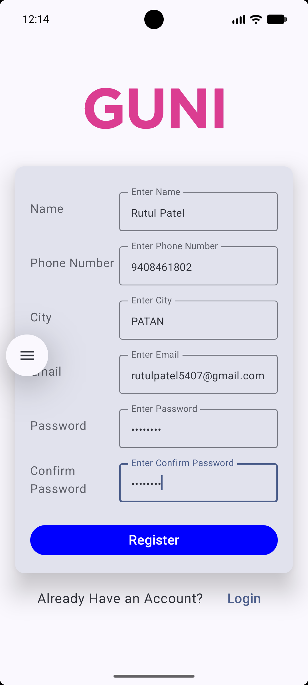

# Practical 5: Login and Registration using Jetpack Compose

## Student Information

- **Enrollment No.:** 24012011123
- **Department:** Computer Engineering
- **Subject:** Mobile Application Development

---

## Aim
To create an Android application with Login and Registration screens using Jetpack Compose.

## Overview
The app has two screens built entirely with composable functions, with navigation between them.

- **Login screen**: logo, Email and Password fields, a Login button and a "SIGN UP" link.
- **Register screen**: logo, Name, Phone Number (digits only), City, Email, Password and Confirm Password fields, a Register button and a "Login" link.
- Both screens show a Toast when the main button is tapped.
- Both screens scroll, so the form stays reachable on small screens and with the keyboard open.

## Project Structure
```
app/src/main/java/com/example/a24012011123_mad_practical_5/
├── MainActivity.kt      # Entry point, sets the theme and starts navigation
├── AppNavigation.kt     # NavHost with the "login" and "register" routes
├── LoginScreen.kt       # Login UI
├── RegisterScreen.kt    # Registration UI
├── FormField.kt         # Reusable label + text field (password / numeric / email modes)
└── ui/theme/            # Material 3 colors, theme and typography
```

## Technologies Used
- Kotlin
- Jetpack Compose
- Material 3
- Navigation Compose
- Android Studio

## Output

<table align="center">
  <tr>
    <td align="center"></td>
    <td align="center"></td>
  </tr>
  <tr>
    <td align="center"><b>Login Screen</b></td>
    <td align="center"><b>Register Screen</b></td>
  </tr>
</table>
